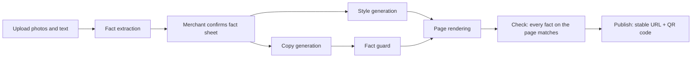

# Shizhao (实招)

**AI styles the page. It never changes the facts.**

Shizhao turns a small shop's product photos and a few lines of text into a mobile promo page. AI handles layout, colors and mood copy. Prices, product names and phone numbers come only from a fact sheet the merchant has confirmed, and a fact guard blocks exaggerated or invented claims.

[中文](README.md) · [Contributing](CONTRIBUTING.md) · [Roadmap](ROADMAP.md) · [Copy-check API](docs/API.md) · [References](docs/REFERENCES.md)

Most project documents are in Simplified Chinese; this page summarizes them in English.

<!-- Demo GIF: record it to docs/assets/demo.gif, then uncomment the next line.

-->

## Positioning

Among the open-source projects we searched on GitHub and Gitee, we found none that covers Chinese marketing copy, a merchant-confirmed fact sheet, and China's Advertising Law / WeChat external-link rules together. Shizhao puts all three in one pipeline: extract the facts, have the merchant confirm them, and only then let AI work on everything around the facts.

## Key numbers

| Metric | Result | Source |
|---|---|---|
| Time to generate one page | To be filled in after rerunning with a real model | `eval/reports/` |
| Block rate / false-positive rate (rules + model judge) | To be filled in after rerunning with a real model | `eval/reports/` |
| Comparison: AI writes the whole page vs Shizhao | To be filled in after rerunning with a real model | `eval/reports/` |
| Automated tests | 768 tests, all passing (2026-10-14, commit `dd054cc`) | `pnpm test` |

The report currently in `eval/reports/2026-10-13/` was produced with the mock model to verify the pipeline. Its numbers are meaningless and are not quoted.

**Independent holdout set (rule layer only)**: 80 cases, 52 that should be blocked and 28 that should pass. Cases were written from the functional spec by someone who never saw the implementation, frozen and hashed before the run, and run exactly once against a fixed commit without any rule or case changes. No model was called. Block rate 63.5% (33/52, 95% CI 49.9%–75.2%); false-positive rate 21.4% (6/28, 95% CI 10.2%–39.5%). Misses were mostly paraphrased ingredient, origin, efficacy and implied-ranking claims; false positives came mostly from Chinese idioms containing numbers.

The rule layer only recognizes listed words and patterns, so paraphrases can slip through; the optional model judge layer is there to catch them. Combined results will come from the real-model evaluation report.

## Pipeline



- **Extraction**: a vision model reads product names, prices, specs and shop details into a draft fact sheet.
- **Confirmation**: the merchant reviews and confirms it; generation only uses confirmed revisions.
- **Style**: the model outputs constrained style parameters (template, palette, font pairing, decoration, hero layout), never page code.
- **Copy and fact guard**: the model writes mood copy; the rule layer checks absolute claims and unsupported sales / ranking / efficacy claims, and an optional model judge checks each sentence. Failing sentences are rewritten or removed.
- **Render and check**: facts are filled into templates straight from the fact sheet, not through the model. After rendering, every fact on the page is compared with the fact sheet; any mismatch means no version is created.
- **Publish**: each project has a fixed short URL. Republishing only switches the version it points to, so printed QR codes keep working.

## Status

| Part | Status |
|---|---|
| Scaffold and auth, model adapters, uploads, fact extraction and confirmation | Done |
| Style generation, rendering with 3 templates, fact guard and copy, job orchestration | Done |
| Publishing and QR codes, evaluation suite, copy-check page and API | Done |
| Public page and visit stats, merchant UI, customer corrections | In progress |
| Docker one-click run, `pnpm demo`, CI | In progress |

The full "create project → upload → extract → confirm → generate → publish" flow currently works through the HTTP API (routes in section 6 and revision R1 of [docs/CONTRACT.md](docs/CONTRACT.md)).

## Quick start

Requires Node.js 24 and pnpm (verified with Node 24.14 and pnpm 12.11). Without any model key, the built-in mock model (fixed demo data, no network) is used and the whole flow still runs.

```bash
git clone https://github.com/adamchangshun/shizhao.git   # or https://gitee.com/sheng-changshun/shizhao.git
cd shizhao
pnpm i
cp .env.example .env.local
# Edit .env.local and set ADMIN_TOKEN to a random string of at least 12 characters, e.g. `openssl rand -hex 16`
pnpm db:migrate
pnpm dev
```

Then open:

- `http://localhost:6688/check`: copy-check page, no login needed.
- `http://localhost:6688/login`: sign in with `ADMIN_TOKEN` for the merchant API.
- `http://localhost:6688/api/health`: health check.

Or call the copy-check API directly:

```bash
curl -X POST http://localhost:6688/api/guard \
  -H 'Content-Type: application/json' \
  -d '{"text":"全城销量第一，当天现烤。","facts":["当天现烤"]}'
```

"全城销量第一" (best-selling in town) is blocked as an unsupported sales claim and an absolute claim; "当天现烤" (baked today) is backed by a fact and kept.

To preview what generated pages look like:

```bash
pnpm render:demo
```

This renders all 3 templates with fixed single-item and menu data into `data/demo/<template>-<dataset>/index.html`. Before the first run, install the headless browser once with `pnpm exec playwright install --only-shell chromium` (`pnpm test` does this automatically).

Everyday commands: `pnpm typecheck`, `pnpm lint`, `pnpm test`.

> Docker (`docker compose up`) and the setup scripts (`pnpm bootstrap`, `pnpm demo`) are in progress and will be documented here when ready.

## Using a real model

Set `PROVIDER=openai-compatible` in `.env.local` and fill in the variables below. The repository ships no keys and no model names; use models your service actually offers.

| Service | `LLM_PROFILE` | `LLM_BASE_URL` | Images |
|---|---|---|---|
| Qwen (Alibaba Cloud Model Studio) | `qwen` | `https://dashscope.aliyuncs.com/compatible-mode/v1` | Yes (set a vision model) |
| Zhipu GLM | `glm` | `https://open.bigmodel.cn/api/paas/v4` | Yes (set a vision model) |
| DeepSeek | `deepseek` | `https://api.deepseek.com/v1` | No, text only |
| MoArk (Gitee AI) | `generic` | `https://ai.gitee.com/v1` | No (`generic` is used as text-only) |
| Ollama (local) | `ollama` | `http://localhost:11434/v1` | If the local model supports vision |

```bash
PROVIDER=openai-compatible
LLM_PROFILE=qwen
LLM_BASE_URL=https://dashscope.aliyuncs.com/compatible-mode/v1
LLM_API_KEY=<your key>          # may be empty for Ollama
LLM_MODEL_TEXT=<text model>
LLM_MODEL_VISION=<vision model>
LLM_PRICE_INPUT_PER_1K=0        # CNY per 1K tokens, for cost tracking only
LLM_PRICE_OUTPUT_PER_1K=0
```

Fact extraction reads photos, so the full flow needs at least one image-capable profile (`qwen`, `glm`, or `ollama` with a vision model). Protocol details: [lib/providers/README.md](lib/providers/README.md).

## External services

| Service | Purpose | Required | Where to get it | Cost | If not configured |
|---|---|---|---|---|---|
| LLM API (Qwen, GLM, DeepSeek, MoArk, ...) | Extraction, style, copy, copy judging | No | [Model Studio](https://bailian.console.aliyun.com/), [Zhipu](https://open.bigmodel.cn/), [DeepSeek](https://platform.deepseek.com/), [MoArk](https://ai.gitee.com/) | Pay per use | Mock data is used |
| Ollama | Run open models locally | No | [ollama.com](https://ollama.com/) | Free, uses local compute | Same as above |
| Playwright Chromium | Tests, `pnpm render:demo` | Development only | Installed by `pnpm test` | Free | Tests and demo rendering cannot run; the app is unaffected |
| Domain and HTTPS certificate | Let customers scan the QR code on their phones | For public deployment | A domain registrar; servers in mainland China also need ICP filing | Domain is paid; certificates can be free | Local or LAN access only (public `http://` URLs are rejected at startup) |

## What is open source

- **Open**: all application code, the `packages/fact-guard` rule layer, industry rule packs (`rules/packs/`), evaluation scripts and synthetic samples.
- **Not in the repository**: external model services; merchants' photos, text and generated pages (kept in the deployer's own `data/` directory). Open-sourcing the code never makes merchant content public.

## Open core + commercial services

- **Free and open forever**: everything in this repository, including the fact-guard rule layer, templates, evaluation set, and everything needed to self-host.
- **Commercial services (validation stage)**: a hosted copy-check API with the model judge layer, hosted and maintained industry rule packs, and enterprise private deployment support. Only the API itself exists today and nothing is charged yet. See [docs/API.md](docs/API.md).
- Governance and how revenue is used: [GOVERNANCE.md](GOVERNANCE.md).

## fact-guard as a standalone library

`packages/fact-guard` is a TypeScript library with zero runtime dependencies. It does not depend on Next.js or the database and can check marketing copy anywhere. See [packages/fact-guard/README.md](packages/fact-guard/README.md).

## Evaluation

Scripts, sample format and how to add samples: [eval/README.md](eval/README.md). With a real model configured:

```bash
pnpm eval:extract && pnpm eval:compare && pnpm eval:guard && pnpm eval:report
```

## How it was built

Two models, Claude and Codex, split the work: each module was written by one and reviewed read-only by the other, with fixes and re-reviews whenever a HIGH issue was found. All reviews are public in [docs/review-log.md](docs/review-log.md). As of 2026-10-14 it records 26 review rounds across 10 modules; the round reports total 63 HIGH, 36 MEDIUM and 20 LOW findings (an issue reported in several rounds is counted each time). Of the 102 issues listed in its tables, 63 are fixed and every other one states why it was declined or deferred.

## Contributing

- See [CONTRIBUTING.md](CONTRIBUTING.md) and the beginner tasks in [docs/good-first-issues.md](docs/good-first-issues.md).
- Issues: [GitHub](https://github.com/adamchangshun/shizhao/issues) or [Gitee](https://gitee.com/sheng-changshun/shizhao/issues).
- Report vulnerabilities privately as described in [SECURITY.md](SECURITY.md).
- Code of conduct: [CODE_OF_CONDUCT.md](CODE_OF_CONDUCT.md).

## License

[Apache-2.0](LICENSE). Third-party dependency and font licenses: [THIRD_PARTY_LICENSES.md](THIRD_PARTY_LICENSES.md).
