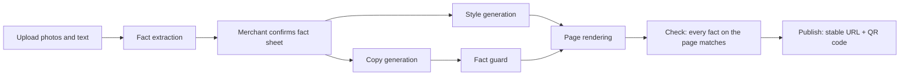

# Shizhao (实招)

**AI styles the page. It never changes the facts.**

Shizhao turns a small shop's product photos and a few lines of text into a mobile promo page. AI handles layout, colors and mood copy. Prices, product names and phone numbers come only from a fact sheet the merchant has confirmed, and a fact guard blocks exaggerated or invented claims.

[中文](README.md) · [Contributing](CONTRIBUTING.md) · [Roadmap](ROADMAP.md) · [Copy-check API](docs/API.md) · [References](docs/REFERENCES.md)

Most project documents are in Simplified Chinese; this page summarizes them in English.

<!-- Demo GIF: record it to docs/assets/demo.gif, then uncomment the next line.

-->

## Positioning

Among the open-source projects we searched on GitHub and Gitee, we found none that covers Chinese marketing copy, a merchant-confirmed fact sheet, and China's Advertising Law / WeChat external-link rules together. Shizhao puts all three in one pipeline: extract the facts, have the merchant confirm them, and only then let AI work on everything around the facts.

## Key numbers

| Metric | Result | Source |
|---|---|---|
| Model time to generate one page | 19.12 s per run on average, end to end (qwen-plus + qwen3-vl-plus, 3 samples × 3 runs, 2026-10-20) | [Evaluation and validation](#evaluation-and-validation) |
| Comparison: fact errors per page | AI writes the whole page: 0.14; Shizhao end to end: 0.33 (both from raw photos and text, merchant changes nothing; small sample, see below) | [Evaluation and validation](#evaluation-and-validation) |
| Rule-layer holdout block rate / false-positive rate | 63.5% / 21.4% (80 cases, rule layer only) | [Evaluation and validation](#evaluation-and-validation) |
| Automated tests | 1490 tests passing plus 1 todo (2026-10-28, 65 test files) | `pnpm test` |

## Pipeline



- **Extraction**: a vision model reads product names, prices, specs and shop details into a draft fact sheet.
- **Confirmation**: the merchant reviews and confirms it; generation only uses confirmed revisions.
- **Style**: the model outputs constrained style parameters (template, palette, font pairing, decoration, hero layout), never page code.
- **Copy and fact guard**: the model writes mood copy; the rule layer checks absolute claims and unsupported sales / ranking / efficacy claims, and an optional model judge checks each sentence. Failing sentences are rewritten or removed.
- **Render and check**: facts are filled into templates straight from the fact sheet, not through the model. After rendering, every fact on the page is compared with the fact sheet; any mismatch means no version is created.
- **Publish**: each project has a fixed short URL `/p/<code>/`. Republishing only switches the version it points to, so printed QR codes keep working. The public page counts visits and tells QR scans from link visits.

## Status

| Part | Status |
|---|---|
| Scaffold and auth, model adapters, uploads, fact extraction and confirmation | Done |
| Style generation, rendering with 3 templates, fact guard and copy, job orchestration | Done |
| Publishing and QR codes, public page and visit stats, merchant console | Done |
| Evaluation suite, copy-check page and API, Docker one-click run and `pnpm demo` | Done |
| Customer corrections, CI, public deployment guide | Done (0.1.0); the on-device acceptance record is not filled in yet |
| 0.2.0: Anthropic adapter, merchant style brief, cross-item borrowing check, fixes for 0.1.0 known issues | Done, see the [CHANGELOG](CHANGELOG.md) |

## Quick start

With no model key configured, the built-in mock model (no network) is used, so the whole "create project → upload → extract → confirm → generate → publish" flow runs with **zero configuration**. The mock model does not read images: if the uploaded text exactly matches the text of a sample in `eval/samples/`, it uses that sample's labels as the draft; any other input gets fixed demo data. The mock returns a fixed model draft that still goes through fact extraction and validation; the merchant must check every field and fill in anything missing. So `pnpm demo` produces a page for the sample shop "麦香小铺", while your own uploads are not really recognized under the mock; to process real material, [use a real model](#using-a-real-model). The evaluation scripts do not use this echo under the mock, so they never score themselves against the answer key.

### Option 1: Docker (recommended)

Requires Docker and Docker Compose.

```bash
git clone https://github.com/adamchangshun/shizhao.git   # or https://gitee.com/sheng-changshun/shizhao.git
cd shizhao
docker compose up
```

- The first run builds the image locally: a cold build takes about 7.5 minutes and the image is about 1.8 GB. To include Playwright Chromium in the image, set `WITH_QA=true` in `.env` and run `docker compose build`.
- Without `ADMIN_TOKEN`, the container generates a random admin token on first start, prints it in the log and keeps it in `data/admin-token`.
- Data (database, uploads, generated pages) lives in the mounted `./data` directory.
- To run the full demo, open another terminal and run `docker compose exec shizhao pnpm demo`.
- To stop: press Ctrl+C in the `docker compose up` terminal, or run `docker compose down` to stop and remove this run's containers and network; the data in `./data` is kept. If you ran the local `pnpm demo` earlier, stop it with Ctrl+C first so the two do not compete for port 6688.

So far this has only been verified with Docker Desktop on macOS (Apple silicon); Docker on Linux and Windows is untested, and issues are welcome.

### Option 2: local pnpm

Requires Node.js 24 and pnpm (verified with Node 24.14 and pnpm 12.11).

```bash
git clone https://github.com/adamchangshun/shizhao.git
cd shizhao
pnpm i
pnpm bootstrap   # creates .env from .env.example (skipped if present), generates and prints an admin token, runs migrations
pnpm demo        # walks the first evaluation sample through the whole flow, prints the public URL, admin token and a terminal QR code
```

With dependencies already cached, a fresh clone gets through `pnpm demo` in about 16 seconds. `pnpm demo` takes the first sample in `eval/samples/` through "create project → upload → extract → confirm → generate → publish" entirely over the HTTP API, then prints the public URL, an admin preview URL (token required), the local path of the generated page, the admin token and a terminal QR code.

If a server is already listening on port 6688, `pnpm demo` uses it; otherwise it starts the dev server and keeps it running after the demo (Ctrl+C stops it). Set `DEMO_API_BASE` to target another address (local http or https only). For everyday development, just run `pnpm dev`.

The QR code points at `PUBLIC_BASE_URL` in `.env` (default `http://localhost:6688`). To scan it with a phone, set it to your computer's LAN address (e.g. `http://192.168.1.10:6688`), keep the phone on the same network, and restart the server.

`pnpm bootstrap` writes `.env` (mode 600). Precedence matches Next.js: shell environment > `.env.local` > `.env`; an empty `ADMIN_TOKEN=` in `.env.local` makes bootstrap exit with an error. `docker compose` only reads `.env`.

To set up by hand instead: `cp .env.example .env.local`, set `ADMIN_TOKEN` there to a random string of at least 12 characters (e.g. from `openssl rand -hex 16`), then run `pnpm db:migrate` and `pnpm dev`.

### After startup

- `http://localhost:6688/`: merchant console; sign in with the admin token to create projects, upload, confirm facts, generate (with optional style preferences: layout, mood words and main color), preview and publish.
- `http://localhost:6688/p/<code>/`: the public page customers see; `pnpm demo` prints the actual URL.
- `http://localhost:6688/check`: copy-check page, no login needed.
- `http://localhost:6688/api/health`: health check.

Or call the copy-check API directly:

```bash
curl -X POST http://localhost:6688/api/guard \
  -H 'Content-Type: application/json' \
  -d '{"text":"全城销量第一。当天现烤。","facts":["当天现烤"]}'
```

The check works sentence by sentence, and the response lists each one under `sentences`: "全城销量第一。" (best-selling in town) is marked `blocked` as an unsupported sales claim and an absolute claim; "当天现烤。" (baked today) is backed by a fact and marked `ok`. One violation marks the whole sentence `blocked`; the offending clause is not cut out on its own, so "全城销量第一，当天现烤。" written as one sentence is blocked as a whole.

To see all templates at once, run `pnpm render:demo`: it renders the 3 templates with fixed single-item and menu data into `data/demo/<template>-<dataset>/index.html`. Before the first run, install the headless browser once with `pnpm exec playwright install --only-shell chromium` (`pnpm test` does this automatically).

Everyday commands: `pnpm typecheck`, `pnpm lint`, `pnpm test`.

### Using the API

Everything the merchant console does is also available through the admin API. Authentication, request bodies and a chain of curl commands you can copy in order, from creating a project to publishing, are in [docs/API-quickstart.md](docs/API-quickstart.md); the route table is in section 6 of [docs/CONTRACT.md](docs/CONTRACT.md).

## Using a real model

Set `PROVIDER=openai-compatible` in `.env` and fill in the variables below (both Docker and local runs read `.env`), then restart. The repository ships no keys and no model names; use models your service actually offers.

| Service | `LLM_PROFILE` | `LLM_BASE_URL` | Images |
|---|---|---|---|
| Qwen (Alibaba Cloud Model Studio) | `qwen` | `https://dashscope.aliyuncs.com/compatible-mode/v1` | Yes (set a vision model) |
| Zhipu GLM | `glm` | `https://open.bigmodel.cn/api/paas/v4` | Yes (set a vision model) |
| DeepSeek | `deepseek` | `https://api.deepseek.com/v1` | No, text only |
| MoArk (Gitee AI) | `generic` | `https://ai.gitee.com/v1` | No (`generic` is used as text-only) |
| Ollama (local) | `ollama` | `http://localhost:11434/v1` | If the local model supports vision |
| Anthropic Claude (Messages protocol) | Leave empty; set `PROVIDER=anthropic` instead | `https://api.anthropic.com/v1` | Yes (set a vision model) |

```bash
PROVIDER=openai-compatible
LLM_PROFILE=qwen
LLM_BASE_URL=https://dashscope.aliyuncs.com/compatible-mode/v1
LLM_API_KEY=<your key>          # may be empty for Ollama
LLM_MODEL_TEXT=<text model>
LLM_MODEL_VISION=<vision model>
LLM_PRICE_INPUT_PER_1K=0        # CNY per 1K tokens, for cost tracking only
LLM_PRICE_OUTPUT_PER_1K=0
```

With `PROVIDER=anthropic`, cost tracking applies Anthropic's published cache multipliers to the input price: cache writes 1.25x (5-minute) or 2x (1-hour), cache reads 0.1x (some newer models are cheaper, so this is an upper bound for them).

For security, `LLM_BASE_URL` may use plain http only for loopback, LAN IPs, `.local` hosts or Docker's `host.docker.internal`; public endpoints must use https or startup fails (`host.docker.internal` is allowed for the model endpoint only, not for `PUBLIC_BASE_URL`).

Under Docker, `localhost` inside the container is the container itself; to reach Ollama on the host, use `http://host.docker.internal:11434/v1` (provided by Docker Desktop).

Fact extraction reads photos, so the full flow needs at least one image-capable profile (`qwen`, `glm`, `ollama` with a vision model, or `PROVIDER=anthropic`). Protocol details: [lib/providers/README.md](lib/providers/README.md).

## External services

| Service | Purpose | Required | Where to get it | Cost | If not configured |
|---|---|---|---|---|---|
| LLM API (Qwen, GLM, DeepSeek, MoArk, ...) | Extraction, style, copy, copy judging | No | [Model Studio](https://bailian.console.aliyun.com/), [Zhipu](https://open.bigmodel.cn/), [DeepSeek](https://platform.deepseek.com/), [MoArk](https://ai.gitee.com/) | Pay per use | The mock model is used (sample or fixed demo data) |
| Ollama | Run open models locally | No | [ollama.com](https://ollama.com/) | Free, uses local compute | Same as above |
| Playwright Chromium | Tests, `pnpm render:demo` | Development only | Installed by `pnpm test` | Free | Tests and demo rendering cannot run; the app is unaffected |
| Domain and HTTPS certificate | Let customers scan the QR code on their phones | For public deployment | A domain registrar; servers in mainland China also need ICP filing | Domain is paid; certificates can be free | Local or LAN access only (public `http://` URLs are rejected at startup) |

## What is open source

- **Open**: all application code, the `packages/fact-guard` rule layer, industry rule packs (`rules/packs/`), evaluation scripts and synthetic samples.
- **Not in the repository**: external model services; merchants' photos, text and generated pages (kept in the deployer's own `data/` directory). Open-sourcing the code never makes merchant content public.

## Open core + commercial services

- **Free and open forever**: everything in this repository, including the fact-guard rule layer, templates, evaluation set, and everything needed to self-host.
- **Commercial services (validation stage)**: a hosted copy-check API with the model judge layer, hosted and maintained industry rule packs, and enterprise private deployment support. Only the API itself exists today and nothing is charged yet. See [docs/API.md](docs/API.md).
- Governance and how revenue is used: [GOVERNANCE.md](GOVERNANCE.md).

## fact-guard as a standalone library

`packages/fact-guard` is a TypeScript library with zero runtime dependencies. It does not depend on Next.js or the database and can check marketing copy anywhere. See [packages/fact-guard/README.md](packages/fact-guard/README.md).

## Evaluation and validation

Scripts, sample format and how to add samples: [eval/README.md](eval/README.md).

### Fact guard rule layer

| Test set | Size | Block rate | False-positive rate | Nature |
|---|---|---|---|---|
| A1 adversarial set | 47 to block, 23 to pass | 95.7% (45/47) | 0% (0/23) | **In-sample**: A1 was consulted during development to tune rules, so it is only a regression set. Numbers are the A1 overall line printed by `pnpm test` on main, 2026-10-21. An earlier ablation (at 44/47) scored 78.7% (37/47) without the A1-derived word lists; it was not rerun |
| A1b independent holdout | 52 to block, 28 to pass | 63.5% (33/52) | 21.4% (6/28) | Independent: written without seeing the implementation, unseen by the implementer before the test, run exactly once |

About the A1b holdout: cases were written from the functional spec by someone who never saw the implementation, frozen and hashed before the run, and run exactly once against a fixed commit without any rule or case changes. No model was called. Block rate 63.5% (33/52, 95% CI 49.9%–75.2%); false-positive rate 21.4% (6/28, 95% CI 10.2%–39.5%). Misses were mostly paraphrased ingredient, origin, efficacy and implied-ranking claims; false positives came mostly from Chinese idioms containing numbers.

The rule layer only recognizes listed words and patterns, so paraphrases can slip through; the optional model judge layer is there to catch them. See experiment 3 below for the combined result.

### Real-model experiments

Numbers below come from [eval/reports/2026-10-20/report.md](eval/reports/2026-10-20/report.md): text model `qwen-plus`, vision model `qwen3-vl-plus` (Alibaba Cloud Model Studio, openai-compatible), runId `openai-compatible-qwen-plus-1020`, commit `dafb379`. **Limits of the evidence**: only 3 samples (7 products), all with script-generated synthetic images, 3 runs per sample, so each row covers only 7–9 pages; the numbers describe these runs and do not generalize. The `eval/reports/2026-10-13/` report in the repository was produced with the mock model to check the pipeline; its numbers are meaningless and must not be quoted.

**Experiment 1: fact extraction accuracy**

| Field | Labeled | Extracted | Correct | Precision | Recall |
|---|---:|---:|---:|---:|---:|
| Product name | 7 | 7 | 5 | 71.4% | 71.4% |
| Price | 7 | 5 | 4 | 80.0% | 57.1% |
| Spec | 3 | 2 | 1 | 50.0% | 33.3% |
| Shop phone | 2 | 2 | 2 | 100.0% | 100.0% |
| Shop address | 2 | 2 | 2 | 100.0% | 100.0% |

**Experiment 2: AI writes the whole page (group A) vs Shizhao (group B)**

| Group | Input | Pages | Fact errors per page | Of which price and name | Unsupported claims per page (rule-layer count) | Avg cost (CNY/run) | Avg model time (s/run) |
|---|---|---:|---:|---:|---:|---:|---:|
| A: AI writes the whole page | Natural-language description of the gold fact sheet | 9/9 | 0.11 | 0.11 | 4.22 | 0.0051 | 54.27 |
| A: AI writes the whole page | Raw photos and text | 7/9 | 0.14 | 0.14 | 3.14 | 0.0037 | 46.34 |
| B: Shizhao (field consistency guaranteed by design) | Gold fact sheet (confirmed) | 8/9 | 0.00 | 0.00 | 0.00 | 0.0024 | 11.09 |
| B: Shizhao (end to end) | Raw photos and text → extract → merchant changes nothing → generate | 9/9 | 0.33 | 0.33 | 0.44 | 0.0038 | 19.12 |

The zeros in the B gold row come from code filling in and checking every field; they are guaranteed by design, not a model result. Only the end-to-end row compares with group A's "raw photos and text" row: all 3 of its errors are the same missed price ("巴斯克芝士蛋糕 6 寸 128 元"), which reaches the page when the merchant changes nothing. This miss (F1) is fixed in 0.2.0, see the [CHANGELOG](CHANGELOG.md); the experiment has not been re-run since the fix.

**Experiment 3: guard block rate and false-positive rate** (`packages/fact-guard/test/cases.zh.json`, 120 cases)

| Judging | Judge model | To block | Blocked | Block rate | To pass | False positives | FP rate |
|---|---|---:|---:|---:|---:|---:|---:|
| Rule layer only | None | 78 | 78 | 100.0% | 42 | 0 | 0.0% |
| Rules + model judge | openai-compatible/qwen-plus | 78 | 78 | 100.0% | 42 | 0 | 0.0% |

This case set was built by the same module as the rule layer, and the rules were written against it, so these scores are optimistic; for unseen claims, see the A1b holdout numbers above.

With a real model configured, rerun all experiments (reports go to `eval/reports/<date>/`):

```bash
pnpm eval:extract && pnpm eval:compare && pnpm eval:guard && pnpm eval:report
```

## Known limitations

- 02/07: openai-compatible model requests have stage-specific output token limits (Anthropic always uses 16000). Fact-guard removes Unicode Cf and Default_Ignorable_Code_Point characters at any position and applies NFKC with source-span mapping. Storage predicates and limited-edition metaphors are hardened, but fresh/bakery weather phrases and event/end wording beside opening hours may still be conservatively blocked. Finite rules do not cover all semantics; see the [fact-guard README](packages/fact-guard/README.md).
- The cross-item borrowing check maps traditional characters only for those in the rule word lists: if item A's tag is 「凤梨香气」, item B writing 「鳳梨香氣」 passes.
- Customer corrections that mention QQ or Alipay are refused whenever the same sentence (up to a full stop, question mark, exclamation mark or line break; commas do not end it) contains a number of 5 or more digits, amounts included ("支付宝付了 12800 元" has to be resubmitted without the number), because amounts and account numbers cannot be told apart reliably. Detection is best effort and deliberately disguised numbers can still get through; see [docs/PRIVACY.md](docs/PRIVACY.md).
- When the vision model names an item only from the image and no price is found in the text, the item takes the name and price of the merchant line with the matching amount. Reworded instructions or plain notes (e.g. "本店最低消费 20元") can still become an item name, as can a Chinese label followed directly by a price-shaped code (e.g. "商品编号123元"); if the vision model misreads a price, the amount may also match another item's line. The new name is flagged, so check every field before confirming the fact sheet.
- Other known issues, including items left over from the security review, are listed under "Known issues" for each release in the [CHANGELOG](CHANGELOG.md).

## How it was built

Two models, Claude and Codex, split the work: each module was written by one and reviewed read-only by the other, with fixes and re-reviews whenever a HIGH issue was found. All reviews are public in [docs/review-log.md](docs/review-log.md). As of 2026-10-14 it records 30 review rounds across 13 modules; the round reports total 4 CRITICAL, 76 HIGH, 45 MEDIUM and 23 LOW findings (an issue reported in several rounds is counted each time). Of the 138 issues listed in its tables, 82 are fixed and the rest state why they were declined, deferred or only recorded.

## Contributing

- See [CONTRIBUTING.md](CONTRIBUTING.md) and the beginner tasks in [docs/good-first-issues.md](docs/good-first-issues.md).
- Issues: [GitHub](https://github.com/adamchangshun/shizhao/issues) or [Gitee](https://gitee.com/sheng-changshun/shizhao/issues).
- Report vulnerabilities privately as described in [SECURITY.md](SECURITY.md).
- Code of conduct: [CODE_OF_CONDUCT.md](CODE_OF_CONDUCT.md).

## License

[Apache-2.0](LICENSE). Third-party dependency and font licenses: [THIRD_PARTY_LICENSES.md](THIRD_PARTY_LICENSES.md).
