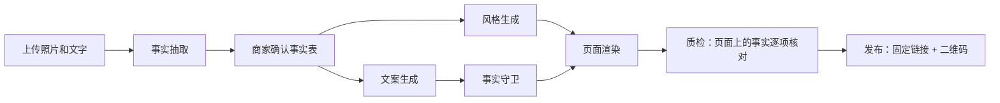

# 实招 Shizhao

**AI 只改颜值，不改事实。**

实招帮小商家把商品照片和几行文字变成一张手机宣传页：AI 负责排版、配色和氛围文案，价格、商品名、电话这些事实只来自商家亲自确认过的事实表，夸大或编造的说法会被事实守卫拦下。

[English](README.en.md) · [贡献指南](CONTRIBUTING.md) · [路线图](ROADMAP.md) · [文案检查 API](docs/API.md) · [参考项目与致谢](docs/REFERENCES.md)

<!-- 演示 GIF：录制后放到 docs/assets/demo.gif，再把下一行取消注释。

-->

## 定位

在我们检索的 GitHub 与 Gitee 开源项目中，未发现同时覆盖中文营销文案、商家确认事实表与广告法 / 微信外链规范的工具。实招把这三件事放在同一条流水线里：先抽取并让商家确认事实，再让 AI 只在事实之外发挥。

## 关键数字

| 指标 | 结果 | 来源 |
|---|---|---|
| 生成一页的模型耗时 | 端到端平均 19.12 秒/次（qwen-plus + qwen3-vl-plus，3 组样本 × 3 次，2026-10-20） | [评测与验证](#评测与验证) |
| 对比实验：每页事实错误 | AI 直接写整页 0.14 处，实招端到端 0.33 处（同为原始图片和文字输入，商家不修改；样本量小，见下文） | [评测与验证](#评测与验证) |
| 规则层独立留出集拦截率 / 误杀率 | 63.5% / 21.4%（80 条，只测规则层） | [评测与验证](#评测与验证) |
| 自动化测试 | 1245 个用例全部通过（2026-10-21，58 个测试文件） | `pnpm test` |

## 工作流程



- **事实抽取**：视觉模型从照片和文字中读出商品名、价格、规格、店铺信息，生成事实表草稿。
- **商家确认**：商家逐项核对后确认；之后的生成只使用已确认的版本。
- **风格生成**：模型只输出受约束的风格参数（模板、配色、字体搭配、装饰、首屏布局），不写页面代码。
- **文案生成与事实守卫**：模型写氛围文案，守卫先用规则层检查绝对化用语、无依据的销量 / 排名 / 功效等说法，可选的模型判定层再逐句判断；不通过的句子会被改写或删除。
- **渲染与质检**：价格、商品名、电话等事实由模板直接从事实表填入，不经过模型；渲染后逐项核对页面上的事实与事实表完全一致，不一致就不生成版本。
- **发布**：每个项目有固定短链接 `/p/<短码>/`，重新发布只切换指向的版本，已经打印出去的二维码继续有效；公开页统计访问量，区分扫码与链接访问。

## 当前进度

| 部分 | 状态 |
|---|---|
| 脚手架与鉴权、模型适配层、素材上传、事实抽取与确认 | 已完成 |
| 风格生成、页面渲染与 3 套模板、事实守卫与文案生成、生成任务编排 | 已完成 |
| 发布与二维码、顾客访问的公开页与访问统计、商家操作界面 | 已完成 |
| 评测集与对比实验、文案检查页与 API、Docker 一键运行与 `pnpm demo` | 已完成 |
| 顾客纠错、CI、公网部署说明 | 待完成 |

## 快速开始

不配置任何模型密钥时，系统自动使用内置的 Mock 模型（不联网），**零配置**即可跑通「建项目 → 上传 → 抽取 → 确认 → 生成 → 发布」全流程。Mock 模型不识别图片：上传的文字与 `eval/samples/` 中某个示例的文字完全一致时，用该示例的标注作为草稿，其他任何内容都用固定的演示数据。Mock 返回固定的模型草稿，仍会经过事实抽取与校验；商家必须逐项核对，缺失字段要补齐。所以 `pnpm demo` 会生成示例店铺「麦香小铺」的页面，而你自己上传的素材在 Mock 下不会被真正识别；要处理真实素材，请[接入真实模型](#接入真实模型)。评测脚本在 Mock 下不使用这项回显，不会拿标准答案给自己打分。

### 方式一：Docker（推荐）

需要 Docker 与 Docker Compose。

```bash
git clone https://github.com/adamchangshun/shizhao.git   # 或 https://gitee.com/sheng-changshun/shizhao.git
cd shizhao
docker compose up
```

- 首次运行会在本机构建镜像：冷构建约 7.5 分钟，镜像约 1.8 GB。需要在容器内使用 Playwright Chromium 时，可在 `.env` 中设置 `WITH_QA=true` 后执行 `docker compose build`。
- 没有设置 `ADMIN_TOKEN` 时，容器首次启动会随机生成管理口令，打印在日志中，并保存在 `data/admin-token`。
- 数据（数据库、上传的素材、生成的页面）保存在挂载的 `./data` 目录。
- 想跑一遍完整演示，另开一个终端执行 `docker compose exec shizhao pnpm demo`。
- 停止：在运行 `docker compose up` 的终端按 Ctrl+C，或执行 `docker compose down` 停止并移除本次的容器与网络；`./data` 中的数据仍然保留。如果之前运行过本地 `pnpm demo`，先按 Ctrl+C 停掉它，避免两者占用同一个 6688 端口。

目前只在 macOS（Apple 芯片）的 Docker Desktop 上验证过；Linux 与 Windows 上的 Docker 尚未实测，遇到问题欢迎提 issue。

### 方式二：本地 pnpm

需要 Node.js 24 和 pnpm（已在 Node 24.14、pnpm 12.11 上验证）。

```bash
git clone https://github.com/adamchangshun/shizhao.git
cd shizhao
pnpm i
pnpm bootstrap   # 从 .env.example 生成 .env（已存在则跳过），随机生成并打印管理口令，执行数据库迁移
pnpm demo        # 用第一组评测样本走完全流程，打印公开页链接、管理口令和终端二维码
```

在依赖已缓存的机器上，从全新 clone 到 `pnpm demo` 结束约 16 秒。`pnpm demo` 用 `eval/samples/` 的第一组样本，全程通过 HTTP 接口完成「建项目 → 上传 → 抽取 → 确认 → 生成 → 发布」，最后打印公开页链接、管理预览链接（需要口令）、生成页面的本地文件路径、管理口令和终端二维码。

6688 端口已有服务时 `pnpm demo` 直接使用它；没有时会自动启动开发服务器并在演示结束后保持运行，按 Ctrl+C 停止。要连接别的地址，可设置 `DEMO_API_BASE`（只允许本机 http 地址或 https 地址）。以后日常开发直接运行 `pnpm dev` 即可。

二维码内容取自 `.env` 中的 `PUBLIC_BASE_URL`（默认 `http://localhost:6688`）。想用手机扫码打开，把它改成电脑的局域网地址（例如 `http://192.168.1.10:6688`），手机和电脑连同一个网络，再重新启动服务。

`pnpm bootstrap` 生成的是 `.env`（权限 600）。环境变量的优先级与 Next.js 相同：命令行环境变量 > `.env.local` > `.env`；`.env.local` 里如果有空的 `ADMIN_TOKEN=`，bootstrap 会报错退出。`docker compose` 只读取 `.env`。

也可以不用 bootstrap 手动准备：`cp .env.example .env.local`，在其中把 `ADMIN_TOKEN` 设为至少 12 位的随机字符串（例如 `openssl rand -hex 16` 的输出），再执行 `pnpm db:migrate` 和 `pnpm dev`。

### 启动后可以访问

- `http://localhost:6688/`：商家后台，用管理口令登录后可以建项目、上传、确认事实、生成、预览和发布。
- `http://localhost:6688/p/<短码>/`：顾客看到的公开页，`pnpm demo` 会打印实际地址。
- `http://localhost:6688/check`：文案检查页，粘贴一段宣传文案即可看到哪些说法会被拦截，无需登录。
- `http://localhost:6688/api/health`：健康检查。

也可以直接调用文案检查接口：

```bash
curl -X POST http://localhost:6688/api/guard \
  -H 'Content-Type: application/json' \
  -d '{"text":"全城销量第一。当天现烤。","facts":["当天现烤"]}'
```

检查按句进行，结果在响应的 `sentences` 里逐句给出：「全城销量第一。」因无依据的销量说法和绝对化用语被标为 `blocked`，「当天现烤。」有事实依据，标为 `ok`。一句里只要有一处违规，整句都标为 `blocked`，不会自动删掉其中的违规分句；所以如果写成「全城销量第一，当天现烤。」，整句都会被拦截。

想一次看完全部模板，可以运行 `pnpm render:demo`：它用固定的单品和菜单数据渲染 3 套模板，输出到 `data/demo/<模板>-<数据>/index.html`。首次运行前需要执行一次 `pnpm exec playwright install --only-shell chromium` 安装无界面浏览器（`pnpm test` 会自动安装）。

开发常用命令：`pnpm typecheck`、`pnpm lint`、`pnpm test`。

### 通过 API 使用

商家后台能做的事都可以直接调用管理 API 完成。鉴权方式、各请求体，以及一组从新建项目到发布可以按顺序复制执行的 curl 示例，见 [docs/API-quickstart.md](docs/API-quickstart.md)；路由总表见 [docs/CONTRACT.md](docs/CONTRACT.md) 第 6 节。

## 接入真实模型

在 `.env` 中设置 `PROVIDER=openai-compatible`，再按下表填写（Docker 和本地运行都读取 `.env`），然后重启服务。仓库不内置任何密钥，也不内置模型名，请填写你所用服务中实际可用的模型。

| 服务 | `LLM_PROFILE` | `LLM_BASE_URL` | 图片识别 |
|---|---|---|---|
| 通义千问（阿里云百炼） | `qwen` | `https://dashscope.aliyuncs.com/compatible-mode/v1` | 支持（需填写视觉模型） |
| 智谱 | `glm` | `https://open.bigmodel.cn/api/paas/v4` | 支持（需填写视觉模型） |
| DeepSeek | `deepseek` | `https://api.deepseek.com/v1` | 不支持，只能处理文字 |
| 模力方舟 | `generic` | `https://ai.gitee.com/v1` | 不支持（`generic` 只按文字接口使用） |
| Ollama（本机运行） | `ollama` | `http://localhost:11434/v1` | 需要本机模型支持视觉 |

```bash
PROVIDER=openai-compatible
LLM_PROFILE=qwen
LLM_BASE_URL=https://dashscope.aliyuncs.com/compatible-mode/v1
LLM_API_KEY=<你的密钥>          # Ollama 可留空
LLM_MODEL_TEXT=<文本模型名>
LLM_MODEL_VISION=<视觉模型名>
LLM_PRICE_INPUT_PER_1K=0        # 每千 token 单价（元），只用于成本统计
LLM_PRICE_OUTPUT_PER_1K=0
```

用 Docker 运行时，容器里的 `localhost` 指向容器自身，连接本机的 Ollama 要把地址写成 `http://host.docker.internal:11434/v1`（Docker Desktop 提供该主机名）。

事实抽取需要读照片，所以要完整使用实招，至少要有一个支持图片的配置（`qwen`、`glm` 或带视觉模型的 `ollama`）。各配置的协议细节见 [lib/providers/README.md](lib/providers/README.md)。

## 外部服务

| 服务 | 用途 | 是否必需 | 在哪申请 | 是否收费 | 不配置时 |
|---|---|---|---|---|---|
| 大模型接口（通义千问、智谱、DeepSeek、模力方舟等） | 事实抽取、风格、文案、文案判定 | 否 | [阿里云百炼](https://bailian.console.aliyun.com/)、[智谱开放平台](https://open.bigmodel.cn/)、[DeepSeek 开放平台](https://platform.deepseek.com/)、[模力方舟](https://ai.gitee.com/) | 按调用量收费 | 使用 Mock 模型（示例数据或固定演示数据） |
| Ollama | 在本机运行开源模型 | 否 | [ollama.com](https://ollama.com/) 下载 | 免费，占用本机算力 | 同上 |
| Playwright Chromium | 运行测试、`pnpm render:demo` | 仅开发时需要 | `pnpm test` 自动安装 | 免费 | 测试和演示渲染无法运行，应用本身不受影响 |
| 域名与 HTTPS 证书 | 让顾客在手机上扫码打开 | 公网部署时必需 | 域名注册商；中国大陆服务器还需 ICP 备案 | 域名收费，证书可免费 | 只能在本机或局域网访问（环境校验拒绝公网 http 地址） |

## 开源范围

- **开放**：应用全部代码、`packages/fact-guard` 规则层、行业规则包（`rules/packs/`）、评测脚本与合成样本。
- **不在仓库中**：外部模型服务；商家上传的照片、文字和生成的页面（保存在部署方自己的 `data/` 目录）。商家素材不会因为代码开源而公开。

## 开源核心 + 商业服务

- **永久开源免费**：本仓库的全部代码，包括事实守卫规则层、模板、评测集和自部署所需的一切。
- **商业服务（验证阶段）**：托管的文案检查 API（含模型判定层）、行业规则包的托管与持续更新、企业私有部署支持。目前只开放了接口本身，尚未收费，详见 [docs/API.md](docs/API.md)。
- 治理方式与收入用途见 [GOVERNANCE.md](GOVERNANCE.md)。

## fact-guard：可单独使用的文案守卫

`packages/fact-guard` 是零运行时依赖的 TypeScript 库，不依赖 Next.js 和数据库，可以单独用于任何营销文案检查场景。用法见 [packages/fact-guard/README.md](packages/fact-guard/README.md)。

## 评测与验证

评测脚本、样本格式和新增样本的方法见 [eval/README.md](eval/README.md)。

### 事实守卫规则层

| 测试集 | 规模 | 拦截率 | 误杀率 | 性质 |
|---|---|---|---|---|
| A1 对抗集 | 应拦截 47 条、应放行 23 条 | 95.7%（45/47） | 0%（0/23） | **样本内成绩**：A1 在开发期间被实现方参考并用于调整规则，只作回归集；数字为 2026-10-21 当前 main 上 `pnpm test` 的 A1 overall 输出。早期（当时为 44/47）去掉只来自 A1 的词表后为 78.7%（37/47），该消融未随本次重测 |
| A1b 独立留出集 | 应拦截 52 条、应放行 28 条 | 63.5%（33/52） | 21.4%（6/28） | 独立留出：出题方不接触实现，实现方测试前看不到题目，只运行一次 |

A1b 留出集的说明（原文）：

> 我们另外构造了一个 80 条的留出测试集，其中应拦截 52 条、应放行 28 条。出题方只依据功能规格出题，不接触实现代码；实现方在测试前看不到题目。题目在运行前冻结并记录哈希，之后对指定提交只运行了一次，期间没有调整规则或用例。这次只测试了规则层，没有调用模型：拦截率为 63.5%（33/52，95% 置信区间 49.9%～75.2%），误杀率为 21.4%（6/28，95% 置信区间 10.2%～39.5%）；漏拦主要集中在换说法的成分、产地、功效声明和隐含排名，误杀主要来自含数字的成语。

规则层只能识别列出的词和模式，换个说法就可能漏过，所以还有可选的模型判定层兜底；两层合计的效果见下面实验三。

### 真实模型对比实验

以下数字来自 [eval/reports/2026-10-20/report.md](eval/reports/2026-10-20/report.md)：文本模型 `qwen-plus`、视觉模型 `qwen3-vl-plus`（阿里云百炼 openai-compatible），runId `openai-compatible-qwen-plus-1020`，被测提交 `dafb379`。**证据限制**：只有 3 组样本（7 个商品），全部是脚本生成的合成图片，每组每样本只跑 3 次，每行只有 7–9 个页面；数字只描述这几次运行，不能推广为泛化结论。仓库里的 `eval/reports/2026-10-13/` 是用 Mock 模型生成的流程验证报告，其中的数字没有意义，不可引用。

**实验一：事实抽取准确率**

| 字段 | 标注数 | 抽取数 | 正确数 | 准确率 | 召回率 |
|---|---:|---:|---:|---:|---:|
| 商品名 | 7 | 7 | 5 | 71.4% | 71.4% |
| 价格 | 7 | 5 | 4 | 80.0% | 57.1% |
| 规格 | 3 | 2 | 1 | 50.0% | 33.3% |
| 店铺电话 | 2 | 2 | 2 | 100.0% | 100.0% |
| 店铺地址 | 2 | 2 | 2 | 100.0% | 100.0% |

**实验二：AI 直接写整页（对照组 A）vs 实招（实验组 B）**

| 组别 | 输入 | 页面数 | 每页事实错误 | 其中价格与商品名 | 每页无依据说法（规则层计数） | 平均成本（元/次） | 平均模型耗时（秒/次） |
|---|---|---:|---:|---:|---:|---:|---:|
| 对照组 A：AI 直接写整页 | gold 事实表的自然语言描述 | 9/9 | 0.11 | 0.11 | 4.22 | 0.0051 | 54.27 |
| 对照组 A：AI 直接写整页 | 原始图片和文字 | 7/9 | 0.14 | 0.14 | 3.14 | 0.0037 | 46.34 |
| 实验组 B：实招（由设计保证的字段一致性） | gold 事实表（已确认） | 8/9 | 0.00 | 0.00 | 0.00 | 0.0024 | 11.09 |
| 实验组 B：实招（端到端） | 原始图片和文字 → 抽取 → 商家不修改 → 生成 | 9/9 | 0.33 | 0.33 | 0.44 | 0.0038 | 19.12 |

B 组 gold 输入一行的 0 是代码直接填入并逐字段核对的结果，由设计保证，不是模型效果。端到端一行才能与对照组 A 的「原始图片和文字」一行比较：这一行的 3 处错误全部是同一个漏抽的价格（「巴斯克芝士蛋糕 6 寸 128 元」，见[已知限制](#已知限制)），商家不修改时就传到了页面上。

**实验三：守卫拦截率与误伤率**（`packages/fact-guard/test/cases.zh.json`，120 条）

| 判定方式 | 判定层模型 | 应拦截 | 拦截 | 拦截率 | 应放行 | 误伤 | 误伤率 |
|---|---|---:|---:|---:|---:|---:|---:|
| 仅规则层 | 无 | 78 | 78 | 100.0% | 42 | 0 | 0.0% |
| 规则层 + 模型判定层 | openai-compatible/qwen-plus | 78 | 78 | 100.0% | 42 | 0 | 0.0% |

该用例集与规则层由同一模块建立，规则是对照这些用例编写的，成绩偏乐观；对未见过的说法，请看上面 A1b 独立留出集的数字。

接入真实模型后，用下面的命令重跑全部实验，报告输出到 `eval/reports/<日期>/`：

```bash
pnpm eval:extract && pnpm eval:compare && pnpm eval:guard && pnpm eval:report
```

## 已知限制

- 02/07：模型请求按场景限制输出 token；事实守卫删除任意位置的 Unicode Cf 与 Default_Ignorable_Code_Point 字符，并做带原文位置映射的 NFKC。天气保存谓语和限定修辞已有补强，但天气中的「新鲜／烘焙」及营业时刻中的「活动／结束」仍可能误拦；有限规则不能覆盖全部语义，详见 [fact-guard README](packages/fact-guard/README.md)。

- 顾客纠错拒绝个人信息时，提到 QQ 或支付宝的那一句里出现 5 位以上的数字一律拒绝，金额也不例外（「支付宝付了 12800 元」需要去掉数字后再提交），因为金额和账号无法可靠区分。识别是尽力而为，刻意变形的写法仍可能漏过，详见 [docs/PRIVACY.md](docs/PRIVACY.md)。
- F1：商品名和价格之间夹着规格时（如『巴斯克芝士蛋糕 6 寸 128 元』）会漏抽价格，计划在 v0.1.1 修复。在此之前，请在确认事实表前逐项核对并补上价格。

## 如何构建的

本项目由 Claude 和 Codex 两个模型分工开发：每个模块由其中一方编写，另一方只读审查，有 HIGH 级问题时修复后再审，审查记录全部公开在 [docs/review-log.md](docs/review-log.md)。截至 2026-10-14，记录了 13 个模块共 30 轮审查；各轮报告合计 4 条 CRITICAL、76 条 HIGH、45 条 MEDIUM、23 条 LOW（同一问题在多轮中出现时分别计数）。记录表中的 138 条问题里，82 条已修复，其余写明了不采纳、暂缓或只作记录的理由。

## 参与贡献

- 贡献方式见 [CONTRIBUTING.md](CONTRIBUTING.md)，适合新人的任务见 [docs/good-first-issues.md](docs/good-first-issues.md)。
- 问题反馈：[GitHub Issues](https://github.com/adamchangshun/shizhao/issues) 或 [Gitee Issues](https://gitee.com/sheng-changshun/shizhao/issues)。
- 安全漏洞请按 [SECURITY.md](SECURITY.md) 私下报告。
- 行为准则：[CODE_OF_CONDUCT.md](CODE_OF_CONDUCT.md)。

## 许可证

[Apache-2.0](LICENSE)。第三方依赖、字体的许可证见 [THIRD_PARTY_LICENSES.md](THIRD_PARTY_LICENSES.md)。
